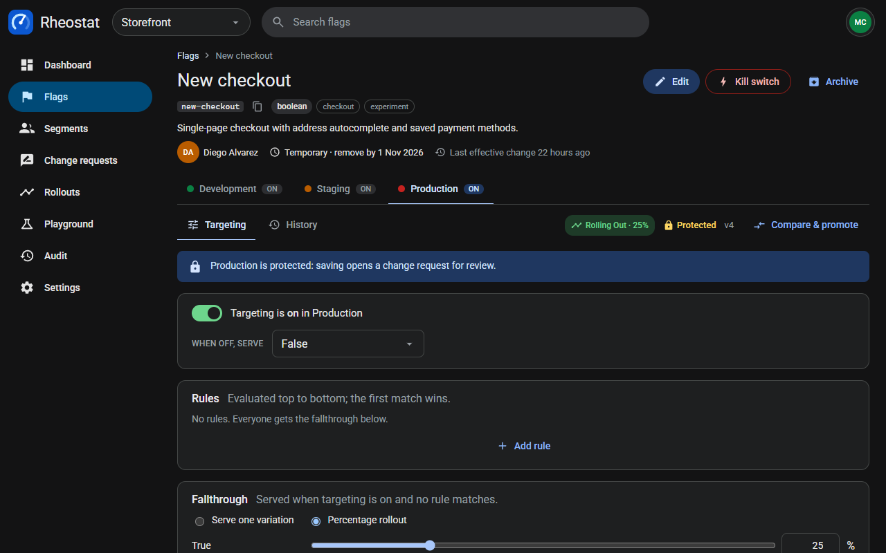

# Rheostat

Rheostat is a feature flag and progressive delivery platform for product teams. Flags carry a separate targeting configuration per environment; protected environments only change through reviewed change requests; rollouts move a flag to a new variation step by step on a schedule and recover safely after a crash; every change is audited, and webhooks notify external tools of what happened. A playground evaluates any flag for any context, and a built-in webhook receiver shows signed deliveries without any external service.



## Built with

| Layer | Choice |
|---|---|
| Runtime and package manager | Bun 1.4 (workspaces; `bun install`, `bun test`) |
| Backend | Express 5, Mongoose 8, Zod 4 (request validation), JSON Web Tokens + bcryptjs (sign-in), dotenv |
| Database | MongoDB 8 on `127.0.0.1:27017`, database `rheostat_db` |
| Frontend | React 19, Vite 8 (rolldown), `@fontsource/roboto`; hand-written CSS with design tokens, no component library |
| Tests | `bun test` — pure business rules, fake-backed workers, real-HTTP route tests, DOM-free render tests, an opt-in MongoDB integration suite |
| Formatting | Prettier 3.6 (`.prettierrc`: tabs, width 140) |

Dependencies are pinned exactly; nothing was added beyond the reference set.

## Project structure

```
rheostat/
├── package.json                 # workspaces: frontend, backend; start / seed / test scripts
├── setup.sh                     # creates .env files from the examples, checks MongoDB, seeds
├── hackerrank.yml               # run: bun start · install: bun install && bash setup.sh --seed
├── .vscode/launch.json          # "Debug Rheostat Application"
├── assets/                      # README media
├── backend/
│   ├── .env.example             # PORT, MONGODB_URI, JWT_*, LOG_LEVEL, API_ORIGIN
│   ├── public/                  # favicon and the API landing page
│   └── src/
│       ├── index.js             # boots the server and the two tickers (rollouts 30 s, webhooks 5 s)
│       ├── app.js               # middleware order, route mounting, /api/v1/health
│       ├── features/            # one folder per domain: route → controller (Zod) → service → repository → model
│       │   ├── auth/            # workspace sign-in, profile switch (JWT)
│       │   ├── people/          # profiles and roles
│       │   ├── projects/        # projects, environment policy, webhook sink token
│       │   ├── flags/           # flags, per-environment configs, versions, lifecycle
│       │   ├── segments/        # reusable audience segments
│       │   ├── governance/      # direct edits, compare and promote, rollback, impact preview
│       │   ├── change-requests/ # proposals, reviews, apply with conflict detection
│       │   ├── rollouts/        # scheduled percentage rollouts and the crash-safe reconciler
│       │   ├── evaluation/      # the evaluator, playground, simulated audience, activity logs
│       │   ├── webhooks/        # subscriptions, signed deliveries, retry worker, built-in receiver
│       │   ├── saved-views/     # per-person flag list filters
│       │   ├── dashboard/       # release health read model
│       │   └── audit/           # the audit log every mutation writes to
│       ├── shared/              # auth/permissions, config, errors, logging, middleware, validation, utils
│       └── scripts/seed.js      # deterministic seed (+ seed/ fixtures per domain)
├── frontend/
│   ├── .env.example             # VITE_API_URL=/api/v1 (Vite proxies to :8000)
│   ├── vite.config.js           # dev server on :3000, proxy, chunking
│   └── src/
│       ├── main.jsx, App.jsx    # bootstrap, session and profile gates, error boundary
│       ├── features/            # one folder per screen family (api client + components + page)
│       └── shared/              # api client and cache, components, context, hooks, router, utils
├── docs/superpowers/            # design specs and implementation plans (the decision record)
├── transcripts/                 # the agent session log delivered with the repository
└── skills/validate/             # the validation skill (kept out of the archive by .gitattributes)
```

## Prerequisites

- Bun ≥ 1.3 (`bun --version`)
- MongoDB ≥ 8 listening on `127.0.0.1:27017` (`mongod` on the PATH, or an already-running server)
- A modern browser; no other services, keys, or accounts

## MongoDB behavior

- Connection: `MONGODB_URI` from `backend/.env` (created from `backend/.env.example` on first run), default `mongodb://localhost:27017/rheostat_db`.
- `setup.sh` starts `mongod` when nothing answers on the port (using `/etc/mongod.conf` when present, otherwise a local `.mongodb/` data directory) and then seeds.
- `bun start` runs `setup.sh --start` first, so **every start resets the database to the seeded baseline**. Changes made while exploring are discarded on the next start; `bun run seed` resets at any time.
- Seeding is deterministic: the same projects, people, flags, versions, change requests, rollouts, webhooks, audit entries, and simulated audience every time. The seeder asserts its own counts and fails loudly on drift.

Baseline counts printed by the seed:

| Collection | Count |
|---|---|
| Profiles / sign-in accounts | 5 / 5 |
| Projects | 2 (Storefront, Mobile app) |
| Segments | 8 |
| Flags | 16 |
| Flag versions | 104 |
| Change requests | 6 |
| Rollout plans | 3 |
| Webhooks / deliveries / receipts | 3 / 14 / 11 |
| Saved views | 3 |
| Audience members | 1000 |
| Evaluation logs | 2772 |
| Audit entries | 114 |

## Run it

```bash
bun install
bun start
```

`bun start` creates the `.env` files, checks MongoDB, seeds, then runs the backend (`bun --watch`, port 8000) and the frontend (Vite, port 3000) together. Open <http://localhost:3000>. The API health check is <http://localhost:8000/api/v1/health> (503 while MongoDB is unreachable).

On HackerRank the same commands are declared in `hackerrank.yml`: install `bun install && bash setup.sh --seed`, run `bun start`.

## Commands

| Command | Purpose |
|---|---|
| `bun start` | Seed, then run backend and frontend with reload |
| `bun run seed` | Reset the database to the seeded baseline |
| `bun run dev:backend` | Backend only (`bun --watch src/index.js`, port 8000) |
| `bun run dev:frontend` | Frontend only (Vite, port 3000, proxies `/api` to 8000) |
| `bun test` | All tests, backend and frontend, from the repository root |
| `MONGODB_TEST_URI=mongodb://localhost:27017/rheostat_test bun test` | Also runs the MongoDB integration suite (concurrency and unique-index behavior) |
| `bunx prettier@3.6.2 --check "backend/src/**/*.js" "frontend/src/**/*.{js,jsx}"` | Formatting check |
| `cd frontend && bun run build` | Production build of the frontend |

## Seeded access

Sign in with any account, then choose a profile. Every seeded account may open every profile, so one sign-in is enough to see the product from each role; the profile menu switches without signing out.

| Email | Password | Role |
|---|---|---|
| `priya.raman@rheostat.team` | `password123` | admin |
| `marcus.chen@rheostat.team` | `password123` | releaseManager |
| `elena.novak@rheostat.team` | `password123` | reviewer |
| `diego.alvarez@rheostat.team` | `password123` | developer |
| `sam.okafor@rheostat.team` | `password123` | viewer |

What each role can do:

| Role | Capabilities |
|---|---|
| viewer | Read everything: dashboard, flags, segments, change requests, rollouts, audit, webhooks; run the playground; keep personal saved views |
| developer | Viewer, plus: create and edit flags and segments; change targeting directly in unprotected environments; propose changes to protected ones; comment on and apply their own approved change requests; plan and manage rollouts in unprotected environments |
| reviewer | Developer, plus: approve or reject change requests |
| releaseManager | Reviewer, plus: apply anyone's approved change request; manage rollouts in protected environments; activate and clear kill switches; archive and restore flags; withdraw any change request; create, edit, test, and delete webhooks |
| admin | Everything, plus: create projects, edit environment protection and required approvals, assign roles (the last admin cannot be demoted) |

## How Rheostat works

1. **Flags** live in a project and hold one targeting configuration per environment (development, staging, production): on/off, rules over context attributes and segments, and a fallthrough that serves one variation or a percentage rollout. Every save creates a numbered version.
2. **Protected environments** (production by default) refuse direct saves. Saving opens a **change request** with the proposed configuration and the base version; reviewers approve or reject; applying it re-checks the base version and marks the request conflicted if the flag moved meanwhile. Compare-and-promote and rollback follow the same rule.
3. **Rollouts** schedule percentage steps for a flag in an environment. A background reconciler applies due steps with a claim and a version-guarded write, detects configuration changes made outside the rollout (stalled), and recovers unambiguously after a crash mid-step. Kill switches hold steps and override evaluation.
4. **Evaluation** is deterministic (hashing by the bucketing attribute); the playground evaluates any context, previews the impact of a proposed configuration on the simulated audience, and the dashboard charts activity.
5. **Webhooks** deliver signed JSON events (flag configuration, kill switch, archive, change request applied, rollout progress) with retries, dead-lettering, a breaker, and redelivery; the built-in receiver verifies signatures and deduplicates.
6. Every mutation writes an **audit** entry; automated writes (rollout steps, dead-lettered deliveries) are attributed to the system actor.

## Engineering notes

| Concept | Where | Trade-off taken |
|---|---|---|
| Optimistic concurrency | `backend/src/features/flags/flag.repository.js` `mutateEnvironment` (version-guarded `findOneAndUpdate`) | One guarded write is the lock and the drift detector; no distributed lock, no transactions (a version is one subdocument). |
| Idempotency | `backend/src/features/audit/audit.service.js` `recordOnce`; unique `(rolloutPlanId, stepId)` on flag versions; unique `(subscriptionId, eventId)` on deliveries; `X-Rheostat-Delivery` for receivers | Deterministic ids for automated writers, random for interactive ones. |
| Background jobs and crash recovery | `backend/src/features/rollouts/reconcile.js` (30 s tick, timestamped claims, four recovery cases); `backend/src/features/webhooks/dispatch.js` (5 s tick, stale-claim release) | Claims with timestamps instead of leases; stale claims resolve deterministically. |
| Queue, retries, backoff, dead-letter, breaker | `backend/src/features/webhooks/` (`WebhookDelivery` as the queue, `BACKOFF_MS`, `MAX_ATTEMPTS`, `BREAKER_THRESHOLD`, `held` deliveries, disabled subscriptions excluded at claim time) | Fixed schedule, one worker; **delivery is at-least-once after a successful enqueue; enqueue is best-effort and logged** (`webhook.emit.failed`); the post-enqueue dispatch kick is separate and best-effort (`webhook.dispatch.kick.failed`) — an outbox is out of scope. |
| Idempotent consumer | the built-in sink (`backend/src/features/webhooks/sink.controller.js`): unique `(projectId, dedupeKey)` receipts with an atomic upsert and `receivedCount` | Duplicate detection is atomic at the database, not check-then-insert. |
| Signed payloads and secrets | `backend/src/features/webhooks/signature.js` (HMAC-SHA256 with timestamp, constant-time compare); secrets shown once | Rotation invalidates receivers until they update. |
| Rate limiting | `backend/src/shared/middleware/rate-limit.js` on login, evaluate, sink | Fixed window, in-memory; boundary bursts accepted. |
| Structured logging and correlation | `backend/src/shared/logging/logger.js`, `backend/src/shared/middleware/request-context.js`, `requestId` in every error envelope, frontend-generated ids | JSON lines to stdout; the seed keeps human-readable output on purpose. |
| RBAC/ABAC | `backend/src/shared/auth/permissions.js` (role × environment protection × authorship) | Context-aware `can()`. Authorization is account-wide by design (no per-project membership); the webhook tests prove resource-relationship integrity (a delivery is only reachable through its own subscription and project; sink tokens bind to their project's subscriptions), not a per-project access boundary. |
| Automated vs user actions | `backend/src/shared/auth/system-actor.js`, `AuditEntry.actorKind` | Worker-written audit entries name the system actor; rollout steps keep the creator's authority but are marked automated. |
| Audit logging | every mutating service awaits `auditService.record`; webhooks emit only after the owning audit succeeds | An unaudited change is a failed request. |
| Indexing and cursor pagination | partial unique index for one active rollout per flag × environment; sparse unique idempotency keys; `(createdAt, _id)` cursors on deliveries (`backend/src/features/webhooks/cursor.js`); `before` cursor on audit | Offset pagination for sorted, filtered user lists; cursors for append-only streams. |
| Health checks | `GET /api/v1/health` (`backend/src/app.js`) | 503 when MongoDB is down. |
| Frontend: cache and dedup | `frontend/src/shared/api/cache.js` (generations, identity-safe in-flight cleanup), `frontend/src/shared/hooks/useAsync.js` | Explicit keys, stale-while-revalidate, committed server data only. |
| Frontend: optimistic updates | comments, rollout pause/resume, kill-switch clear | Only where failure is rare and the rollback is a local swap. |
| Frontend: boundaries, splitting, skeletons, accessibility | `frontend/src/shared/components/ErrorBoundary.jsx`, `frontend/src/features/shell/Workspace.jsx` (`lazy` + `Suspense`), native `<dialog>` with focus restore | Route-level boundaries. |
| Tests | pure business rules, fake-backed workers, real-HTTP tests over fakes, DOM-free render tests, opt-in MongoDB integration suite (`MONGODB_TEST_URI`) | No DOM shim (dependency freeze); interaction verified in browser gates. |

**What a multi-process deployment would change.** The rate-limit store and client cache would move to Redis; the two tickers would take a lease; deliveries would move to a broker with the same claim semantics; enqueue would become a transactional outbox; logs would ship to a collector keyed by `requestId`.
